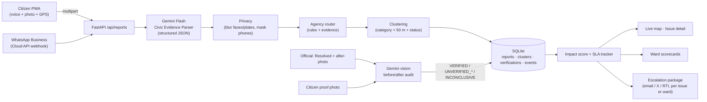

# CivicPulse — from complaint to closure, with proof

**A civic accountability layer for Bengaluru.** Citizens report a pothole, a dead streetlight or a garbage black spot with a 10-second voice note (Kannada, English, Hindi or code-mixed) and a photo, in the PWA or on WhatsApp. Gemini turns it into a structured, routed ticket; duplicate reports are clustered and ranked by civic impact; and when an official marks it "Resolved", **the system checks the proof** — comparing before/after photos, asking nearby citizens for a fresh photo, flagging fake or cosmetic closures, and tracking repairs that fail again inside the warranty window. Ward scorecards make the difference between *closed* and *actually fixed* public.

> Bengaluru does not lack reporting apps (Sahaaya, the pothole app, I Change My City, Fix My Street, X). Complaints stall because of fragmented agencies, zero verification of closures, and repeat failures. CivicPulse is built as a layer **on top of** those channels, not another complaint box.

## What the MVP does

| # | Feature | Where it lives |
|---|---|---|
| 1 | **Multilingual voice + photo intake, in the PWA or on WhatsApp.** Gemini Flash transcribes Kannada/English/Hindi/code-mixed audio and reads the photo (2.5 Flash with an AI Studio key, Gemini 3 Flash on Vertex AI). It emits a validated JSON ticket in the PRD's parser shape: category, severity (low → critical), estimated dimensions in cm, landmark, hazards, evidence flags and confidence. Categories are the PRD's seven, including *unrestored utility trench*, plus Bengaluru extras. Reports nobody can classify are bounced with a prompt to describe the problem. Emergencies get a "call 112" banner, since CivicPulse does not dispatch help. Voice notes are capped at 30 s and photos at 10 MB (JPEG/PNG/WebP). | `backend/app/ai/gemini.py`, `schemas.py`, `services/whatsapp.py` |
| 2 | **Agency routing that ends the ping-pong.** Deterministic rules plus model evidence: a pothole next to a fresh BWSSB pipeline trench is routed to **BWSSB**, with **GBA Roads as secondary** owner for resurfacing; road damage inside metro barricades goes to **BMRCL**, otherwise to the GBA (ex-BBMP) wing that owns it. Every route comes with a one-line reason and a 0–1 routing confidence. The PRD's agency codes (`BBMP_ROADS`, `BESCOM`, `BTP`, …) are returned alongside. | `services/routing.py` |
| 3 | **Clustering + Civic Impact Score.** Same-category reports within **50 m** merge into one issue. The score (0–100, fully explained) uses the PRD weights: **unique citizens 35**, severity 30, context 20 and days elapsed 15. Context is the road hierarchy (arterial road, junction) plus schools, hospitals and transit hubs within 200 m. The same reporter filing the same category within 1 km and 5 min is rejected as a duplicate. | `services/intake.py`, `services/scoring.py` |
| 4 | **Proof-of-fix verification.** On "Resolved", the official's after-photo must be geotagged within 50 m of the issue (EXIF GPS, read before the PWA resizes the photo). Gemini then audits it against the before-photos (same location? actually fixed? proper vs cosmetic?). Every reporter, plus citizens active within 200 m, is asked for a fresh photo through an in-app inbox and an optional webhook. The issue becomes an **Unverified closure** if the AI audit fails, if a citizen's proof photo shows a different spot, or if a new report arrives against the pending closure. | `services/closure.py`, `services/notify.py` |
| 5 | **Repeat-failure tracking.** A verified fix that breaks again within 25 m and 180 days is flagged and linked to the earlier ticket — a warranty claim, not a fresh expense. | `services/intake.py` |
| 6 | **One-click escalation package.** An email to the ward engineer (cc the secondary agency), an X post (≤ 280 characters) tagging the agency, and an RTI application under Section 6(1). Each draft carries cluster ids, coordinates, ISO timestamps, the failure reason and before/after photo links. Packages are built from templates in milliseconds (the PRD asks for under 3 s) and download as `.txt`. A **ward package** (e.g. *Ward 150 Bellandur*) bundles the ward's unverified closures and SLA breaches by agency. Gemini can rewrite a single draft on request. Drafts cite the Sahaaya complaint number once it is linked (assisted filing). | `services/accountability.py`, `ai/templates.py` |
| 7 | **Ward scorecards.** Active issues, verified vs unverified closure rate, SLA breach rate, time to fix and repeat-failure rate per ward, exportable for RWAs, ward committees and the press. | `services/accountability.py`, `frontend/src/pages/ScorecardPage.tsx` |
| 8 | **Privacy and anti-spam.** Phone numbers are masked in every response. Faces and number plates are blurred before a photo is stored. Citizens appear under pseudonyms, and voice notes are private by default. Photos are flagged when they lack camera metadata, carry EXIF GPS far from the pin, or look like stock images or screenshots. Every reporter gets a 0–1 credibility score. | `privacy.py`, `services/intake.py`, `services/credibility.py` |
| 9 | **Kannada + English UI.** One tap in the header switches the whole PWA between English and ಕನ್ನಡ. The choice is remembered per device, and `?lang=kn` links open in Kannada. API vocabulary (categories, statuses, agencies, verdicts, hazards, wards) is translated by id, while citizens' own words and AI explanations are shown as written. Dates are YYYY-MM-DD (IST). | `frontend/src/i18n/` |

The whole system also runs **offline** (no API key): a heuristic parser handles typed text and all accountability logic still works, so the demo never dies on a network blip. Gemini is used when `GEMINI_API_KEY` is set (or Vertex AI is configured) and falls back automatically on errors. Face/plate blurring and photo audits need Gemini.

## Architecture



| Layer | Choice | Why |
|---|---|---|
| Intake | React 19 + Vite PWA (installable, MediaRecorder, camera capture) and a WhatsApp Business webhook | Works on any phone; WhatsApp is where residents already are ([docs/WHATSAPP.md](docs/WHATSAPP.md)) |
| AI | Gemini Flash via `google-genai` (AI Studio key or Vertex AI) with Pydantic response schemas | One multimodal call per report; validated JSON; Kannada speech; face/plate boxes for blurring |
| Geo | Haversine clustering, nearest-ward lookup, sensitive-zone dataset; Leaflet + OSM tiles | Zero-config; swap in Google Maps Platform / GBA GIS later |
| Backend | FastAPI + SQLite (WAL) | Single process, single file DB, trivially deployable to Cloud Run |
| Verification | Gemini vision comparing before/after photos | Flags wrong-location, not-fixed and cosmetic closures |

Full API contract: [`docs/API.md`](docs/API.md).

## Run it locally

Prerequisites: Python 3.11+, Node 20+ (Node 22/24 fine), optionally [`uv`](https://docs.astral.sh/uv/) and `ffmpeg` (used to transcode browser audio to FLAC for Gemini; optional).

```bash
git clone https://github.com/Vibho1/CivicPulse.git && cd CivicPulse
cp .env.example .env            # add GEMINI_API_KEY=... for live voice/vision (optional)

# backend
cd backend
python3 -m venv .venv && .venv/bin/pip install -r requirements-dev.txt   # or: uv venv && uv pip install -r requirements-dev.txt
.venv/bin/python -m scripts.seed_demo                                    # loads the Bengaluru demo story
.venv/bin/uvicorn app.main:app --reload --port 8000                      # http://localhost:8000/docs

# frontend (second terminal)
cd frontend
npm install
npm run dev                                                              # http://localhost:5173 (proxies /api to :8000)
```

Production-style single process: `cd frontend && npm run build`, then start the backend — it serves the built PWA at `/`. Or `docker build -t civicpulse . && docker run -p 8080:8080 -e GEMINI_API_KEY=... civicpulse`.

`make setup`, `make api`, `make web`, `make seed`, `make test` wrap the above.

**Deploy to Google Cloud Run:** the infrastructure is Terraform in [`deploy/terraform`](deploy/terraform) (one public service, Gemini on Vertex AI, data kept in Cloud Storage, optional WhatsApp secrets in Secret Manager); images are built with Cloud Build. Step-by-step: [docs/DEPLOY_GCP.md](docs/DEPLOY_GCP.md).

### Tests

```bash
cd backend && .venv/bin/python -m pytest -q      # geo, heuristics, routing (+secondary owner, confidence), PRD score, 50 m clustering, duplicate guard, GPS proof check, proof requests, closure state machine, escalation packages, privacy, credibility, WhatsApp webhook, HTTP API, DB migration, demo seed
cd frontend && npm run typecheck
```

## The 3-minute demo

Seed first (`make seed` or the **Demo → Seed** menu in the app). AI status pill shows *Gemini live* when the key is set.

1. **Report in Kannada.** On `/report`, pick the "ORR service lane, Bellandur" preset, record *"Outer Ring Road service lane alli Ecospace hatra dodda gundi ide"*, attach a pothole photo showing the blue pipeline trench. The ticket appears already **routed to BWSSB** with the reason ("fresh trench backfill / water pipe visible") and merges into the existing 4-report cluster — watch the impact score climb.
2. **Clustering + score.** Open the issue: reports in Kannada, English and Hindi. The score breakdown uses the PRD weights (unique citizens, critical severity, arterial road, days elapsed with "SLA breached by 3 days"). You also see the timeline and an agency card with helpline, X handle and PRD code.
3. **Fake closure caught.** Switch on **Official mode**, open the Koramangala pothole, "Mark resolved" with the *wrong-spot* photo (`backend/app/data/demo_photos/kor_pothole_after_wrong.jpg`). Gemini returns **UNVERIFIED_DIFFERENT_LOCATION** — "white compound wall, green gate and tree missing" — and the issue flips to **Unverified closure**. Do the same on Jayanagar with the gravel patch → **UNVERIFIED_COSMETIC**.
4. **Proof that it was fixed.** On HSR Layout's garbage black spot, submit the citizen photo → **VERIFIED**; the issue becomes *Verified resolved*.
5. **Repeat failure.** The Agara junction pothole shows "Marked fixed 45 days ago — failed again" linked to its earlier ticket.
6. **Scorecard + escalation.** `/scorecard` shows the unverified-closure rate, HSR's repeat-failure rate and per-ward SLA breaches. **Escalate** on the Bellandur row builds the *Ward 150 Bellandur* package. It covers the unrestored BESCOM cable trench "closed" with loose soil, plus the ward's SLA-breached issues (the ORR pothole and a garbage black spot), as email, X post and RTI, with a `.txt` download. Back on the ORR issue, **Escalation package** gives the same for one issue, and **Rewrite with Gemini** redrafts one channel.

## Repository layout

```
backend/
  app/
    main.py            FastAPI app, CORS, gzip, static media, SPA hosting
    routers/api.py     HTTP endpoints (see docs/API.md); routers/whatsapp.py: WhatsApp Cloud API webhook
    ai/                gemini.py (structured multimodal calls), heuristic.py (offline), templates.py, audio.py (ffmpeg)
    services/          intake.py (parse→route→cluster→score), closure.py (resolve/verify state machine),
                       routing.py, scoring.py, accountability.py (escalation packages, scorecards), present.py,
                       credibility.py, notify.py, whatsapp.py
    domain.py          categories, agencies (+ PRD codes), statuses, SLAs, radii, score weights
    privacy.py         phone-number masking
    geo.py             haversine, wards, sensitive zones, EXIF GPS, photo normalisation, face/plate blurring
    store.py           SQLite persistence
    demo.py            seeded Bengaluru scenario (no model calls)
    data/              wards.json, hotspots.json, demo_photos/
  tests/               pytest suite
  scripts/seed_demo.py, scripts/ai_probe.py
frontend/              React + TypeScript PWA (map, report wizard, issue detail, scorecard)
deploy/                entrypoint.sh, terraform/ (Cloud Run infrastructure as code)
docs/                  API.md (API contract), DEPLOY_GCP.md, WHATSAPP.md
Dockerfile, Makefile, .env.example
```

## Design notes & honest limitations

- **Works alongside official systems.** Filing *into* Sahaaya / agency portals is assisted (escalation packages) until APIs exist. Once filed, `POST /api/clusters/{id}/external-ref` stores the official complaint number, and escalations and RTIs cite it. A webhook (`NOTIFY_WEBHOOK_URL`) can relay proof-photo requests to a WhatsApp/SMS bridge.
- **Verification is evidence, not adjudication.** Verdicts carry confidences and explanations. A photo geotagged more than 50 m from the issue is rejected outright. Officials can contest and re-resolve, and a citizen photo is required for "verified".
- **Spam & abuse.** These checks are in:
  - duplicate merging, and scoring on unique citizens (re-reporting doesn't inflate the score);
  - rejection of the same reporter filing the same category within 1 km / 5 min;
  - an `is_civic_issue` guard and a low-confidence bounce;
  - photo flags: no camera metadata, EXIF GPS far from the pin, stock image or screenshot;
  - a 0–1 reporter credibility score. It is shown next to reports but never hides them or changes the impact score.
- **Privacy.** Photos are re-encoded with metadata stripped. Faces and number plates the model finds are blurred before storage; the offline parser cannot find them. Phone numbers are masked in every response, including escalation drafts. Citizens appear as `citizen-xxxxxx` pseudonyms. Voice notes are private unless `PUBLIC_AUDIO=true`. Coarse public locations are still on the roadmap.
- **Datasets are demo-grade.**
  - Ward centroids and sensitive-zone points/polylines are approximate stand-ins for GBA GIS and OSM layers.
  - Only Bellandur carries its official ward number (150) until the ward GeoJSON is available (PRD OQ-2).
  - SLA hours are configurable assumptions (PRD OQ-4).
  - Agency handles/helplines should be verified before use.
  - Demo photos are AI-generated.
- **Scale.** SQLite + in-process scoring are deliberate for a 48-hour MVP; the `Store` interface is the only thing to swap for Firestore/Postgres.

## Roadmap

Contractor/defect-liability matching from tender data → official ward boundaries and numbers (PRD OQ-2) → coarse public locations → passive pothole detection from fleet accelerometers → monsoon waterlogging early warning → RWA petition mode → push into Sahaaya when an API is available.

## Credits

Inspired by *CrowdFix*, a voice-first civic reporting prototype by team "503: Service Unavailable" at the lablab.ai AI Infra Summit Hackathon. CivicPulse re-frames the idea for Bengaluru around **verification and accountability** rather than reporting alone.
