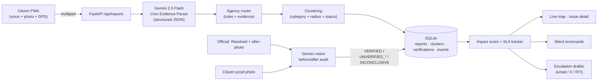

# CivicPulse — from complaint to closure, with proof

**A civic accountability layer for Bengaluru.** Citizens report a pothole, a dead streetlight or a garbage black spot with a 10-second voice note (Kannada, English, Hindi or code-mixed) and a photo. Gemini turns it into a structured, routed ticket; duplicate reports are clustered and ranked by civic impact; and when an official marks it "Resolved", **the system checks the proof** — comparing before/after photos, asking nearby citizens for a fresh photo, flagging fake or cosmetic closures, and tracking repairs that fail again inside the warranty window. Ward scorecards make the difference between *closed* and *actually fixed* public.

> Bengaluru does not lack reporting apps (Sahaaya, the pothole app, I Change My City, Fix My Street, X). Complaints stall because of fragmented agencies, zero verification of closures, and repeat failures. CivicPulse is built as a layer **on top of** those channels, not another complaint box.

## What the MVP does

| # | Feature | Where it lives |
|---|---|---|
| 1 | **Multilingual voice + photo intake.** Gemini 2.5 Flash transcribes Kannada/English/Hindi/code-mixed audio, reads the photo, and emits a validated JSON ticket: category, severity, landmark, size, hazards, evidence flags, confidence. | `backend/app/ai/gemini.py`, `schemas.py` |
| 2 | **Agency routing that ends the ping-pong.** Deterministic rules plus model evidence: a pothole next to a fresh BWSSB pipeline trench is routed to **BWSSB**, road damage inside metro barricades to **BMRCL**, otherwise to the GBA (ex-BBMP) wing that owns it. Every route comes with a one-line reason. | `services/routing.py` |
| 3 | **Clustering + Civic Impact Score.** Same-category reports within a per-category radius merge into one issue. Score (0–100, fully explained) = corroboration + severity + sensitive context (schools, hospitals, arterial roads, junctions) + hazards + SLA pressure + repeat-failure bonus. | `services/intake.py`, `services/scoring.py` |
| 4 | **Proof-of-fix verification.** On "Resolved", the official's after-photo is audited by Gemini against the before-photos (same location? actually fixed? proper vs cosmetic?). Citizens can submit a fresh photo; a new report against an unverified closure reopens it as **disputed**. | `services/closure.py` |
| 5 | **Repeat-failure tracking.** A verified fix that breaks again within 180 days is flagged and linked to the earlier ticket — a warranty claim, not a fresh expense. | `services/intake.py` |
| 6 | **One-click escalation drafts.** Email to the ward engineer, an X post tagging the agency, or an RTI application — generated from the ticket facts once SLAs slip. | `services/accountability.py`, `ai/templates.py` |
| 7 | **Ward scorecards.** Verified vs unverified closure rate, SLA breach rate, time to fix, repeat-failure rate per ward, exportable for RWAs, ward committees and the press. | `services/accountability.py`, `frontend/src/pages/Scorecard.tsx` |

The whole system also runs **offline** (no API key): a heuristic parser handles typed text and all accountability logic still works, so the demo never dies on a network blip. Gemini is used when `GEMINI_API_KEY` is set and falls back automatically on errors.

## Architecture



| Layer | Choice | Why |
|---|---|---|
| Intake | React 19 + Vite PWA (installable, MediaRecorder, camera capture) | Works on any phone; WhatsApp Business intake is the next step |
| AI | Gemini 2.5 Flash via `google-genai` with Pydantic response schemas | One multimodal call per report; validated JSON; Kannada speech |
| Geo | Haversine clustering, nearest-ward lookup, sensitive-zone dataset; Leaflet + OSM tiles | Zero-config; swap in Google Maps Platform / GBA GIS later |
| Backend | FastAPI + SQLite (WAL) | Single process, single file DB, trivially deployable to Cloud Run |
| Verification | Gemini vision comparing before/after photos | Flags wrong-location, not-fixed and cosmetic closures |

Full API contract: [`docs/API.md`](docs/API.md).

## Run it locally

Prerequisites: Python 3.11+, Node 20+ (Node 22/24 fine), optionally [`uv`](https://docs.astral.sh/uv/) and `ffmpeg` (used to transcode browser audio to FLAC for Gemini; optional).

```bash
git clone https://github.com/Vibho1/CivicPulse.git && cd CivicPulse
cp .env.example .env            # add GEMINI_API_KEY=... for live voice/vision (optional)

# backend
cd backend
python3 -m venv .venv && .venv/bin/pip install -r requirements-dev.txt   # or: uv venv && uv pip install -r requirements-dev.txt
.venv/bin/python -m scripts.seed_demo                                    # loads the Bengaluru demo story
.venv/bin/uvicorn app.main:app --reload --port 8000                      # http://localhost:8000/docs

# frontend (second terminal)
cd frontend
npm install
npm run dev                                                              # http://localhost:5173 (proxies /api to :8000)
```

Production-style single process: `cd frontend && npm run build`, then start the backend — it serves the built PWA at `/`. Or `docker build -t civicpulse . && docker run -p 8080:8080 -e GEMINI_API_KEY=... civicpulse`.

`make setup`, `make api`, `make web`, `make seed`, `make test` wrap the above.

### Tests

```bash
cd backend && .venv/bin/python -m pytest -q      # 29 tests: geo, heuristics, routing, scoring, clustering, closure state machine, HTTP API, demo seed
cd frontend && npm run typecheck
```

## The 3-minute demo

Seed first (`make seed` or the **Demo → Seed** menu in the app). AI status pill shows *Gemini live* when the key is set.

1. **Report in Kannada.** On `/report`, pick the "ORR service lane, Bellandur" preset, record *"Outer Ring Road service lane alli Ecospace hatra dodda gundi ide"*, attach a pothole photo showing the blue pipeline trench. The ticket appears already **routed to BWSSB** with the reason ("fresh trench backfill / water pipe visible") and merges into the existing 4-report cluster — watch the impact score climb.
2. **Clustering + score.** Open the issue: 5 reports in Kannada, English and Hindi, score breakdown (arterial road, junction, two-wheeler skid risk, SLA breached by 3 days), timeline, agency card with helpline and X handle.
3. **Fake closure caught.** Switch on **Official mode**, open the Koramangala pothole, "Mark resolved" with the *wrong-spot* photo (`backend/app/data/demo_photos/kor_pothole_after_wrong.jpg`). Gemini returns **UNVERIFIED_DIFFERENT_LOCATION** — "white compound wall, green gate and tree missing" — and the issue flips to **Closure disputed**. Do the same on Jayanagar with the gravel patch → **UNVERIFIED_COSMETIC**.
4. **Proof that it was fixed.** On HSR Layout's garbage black spot, submit the citizen photo → **VERIFIED**; the issue becomes *Resolved – verified*.
5. **Repeat failure.** The Agara junction pothole shows "Marked fixed 45 days ago — failed again" linked to its earlier ticket.
6. **Scorecard + escalation.** `/scorecard`: "50% of closures unverified", HSR's repeat-failure rate, per-ward SLA breaches. Back on the ORR issue, **Draft escalation → Email / X / RTI** in one click.

## Repository layout

```
backend/
  app/
    main.py            FastAPI app, CORS, static media, SPA hosting
    routers/api.py     HTTP endpoints (see docs/API.md)
    ai/                gemini.py (structured multimodal calls), heuristic.py (offline), templates.py, audio.py (ffmpeg)
    services/          intake.py (parse→route→cluster→score), closure.py (resolve/verify state machine),
                       routing.py, scoring.py, accountability.py (escalations, scorecards), present.py
    domain.py          categories, agencies, statuses, SLAs, radii
    geo.py             haversine, wards, sensitive zones, EXIF GPS, photo normalisation
    store.py           SQLite persistence
    demo.py            seeded Bengaluru scenario (no model calls)
    data/              wards.json, hotspots.json, demo_photos/
  tests/               pytest suite
  scripts/seed_demo.py
frontend/              React + TypeScript PWA (map, report wizard, issue detail, scorecard)
docs/API.md            API contract
Dockerfile, Makefile, .env.example
```

## Design notes & honest limitations

- **Works alongside official systems.** Filing *into* Sahaaya / agency portals is assisted (escalation drafts) until APIs exist; the data model keeps an external reference slot for that.
- **Verification is evidence, not adjudication.** Verdicts carry confidences and explanations; officials can contest and re-resolve; a citizen photo is required for "verified".
- **Spam & abuse.** Duplicate merging, EXIF-vs-GPS distance warnings, `is_civic_issue` guard and a reporter id are in; reputation scoring is next.
- **Privacy.** Photos are re-encoded with metadata stripped; the model flags visible faces/plates (`people_or_plates_visible`). Automatic blurring and coarse public locations are on the roadmap.
- **Datasets are demo-grade.** Ward centroids and sensitive-zone points/polylines are approximate stand-ins for GBA GIS and OSM layers; SLA hours are configurable assumptions; agency handles/helplines should be verified before use. Demo photos are AI-generated.
- **Scale.** SQLite + in-process scoring are deliberate for a 48-hour MVP; the `Store` interface is the only thing to swap for Firestore/Postgres.

## Roadmap

WhatsApp Business intake → contractor/defect-liability matching from tender data → face/plate blurring → reporter reputation → passive pothole detection from fleet accelerometers → monsoon waterlogging early warning → RWA petition mode → push into Sahaaya when an API is available.

## Credits

Inspired by *CrowdFix*, a voice-first civic reporting prototype by team "503: Service Unavailable" at the lablab.ai AI Infra Summit Hackathon. CivicPulse re-frames the idea for Bengaluru around **verification and accountability** rather than reporting alone.
