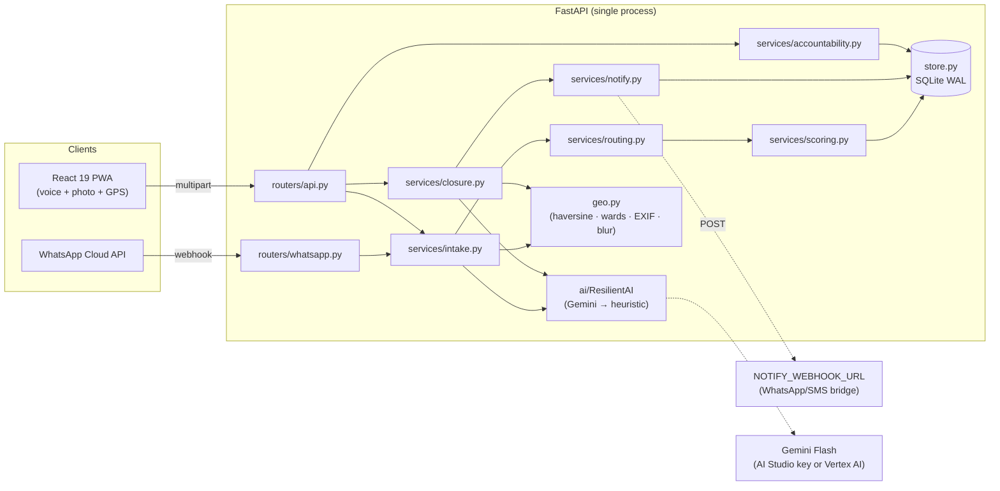
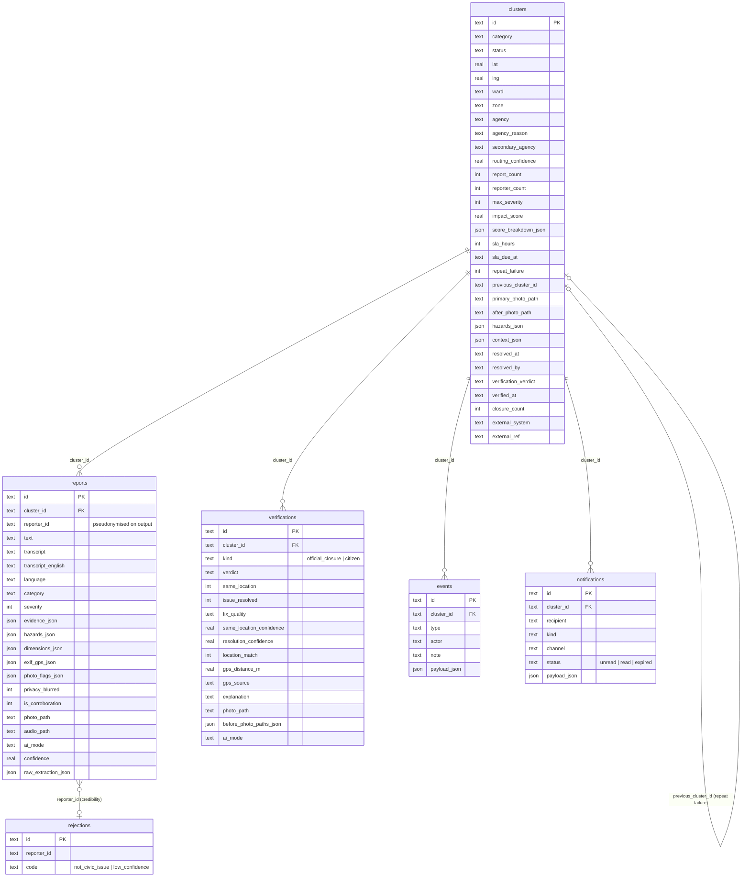
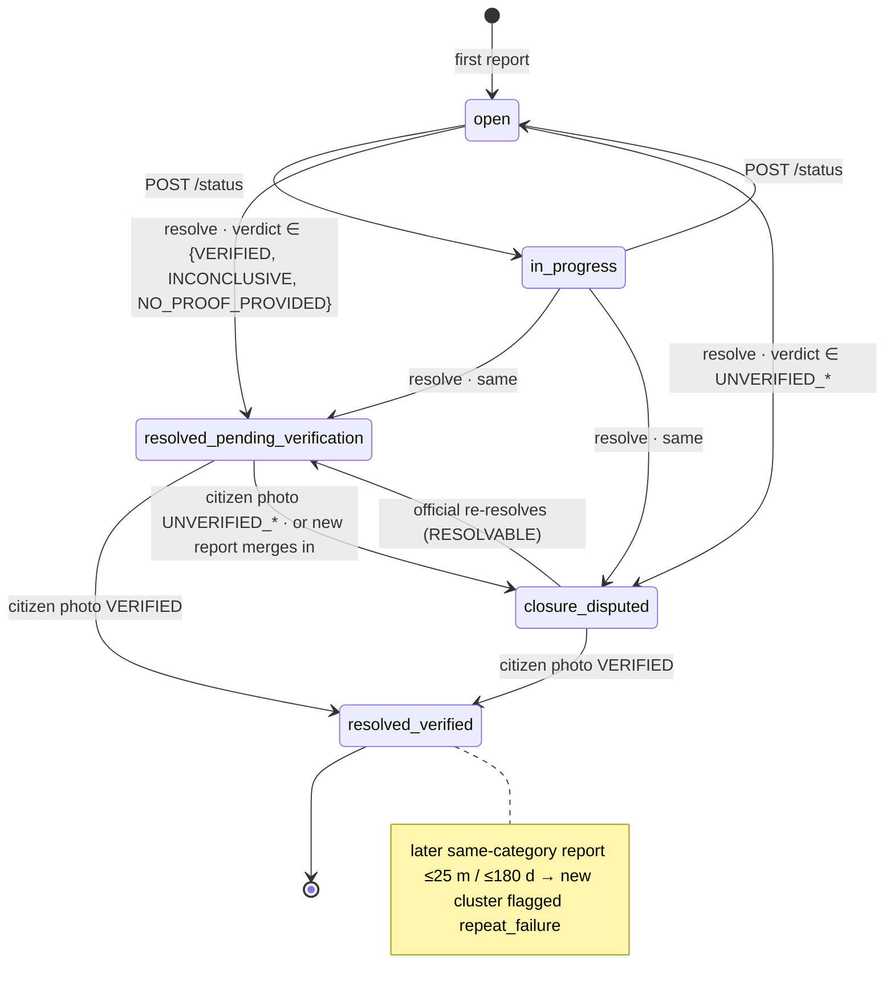
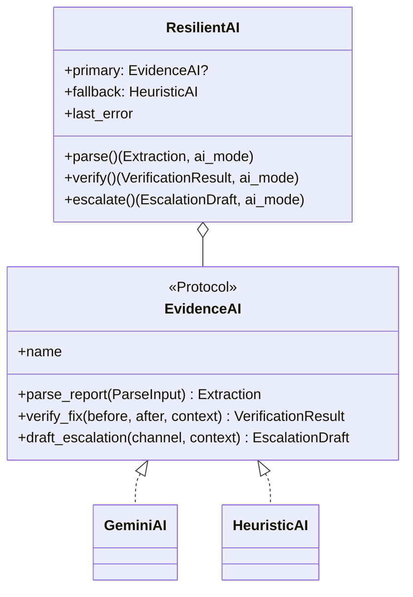
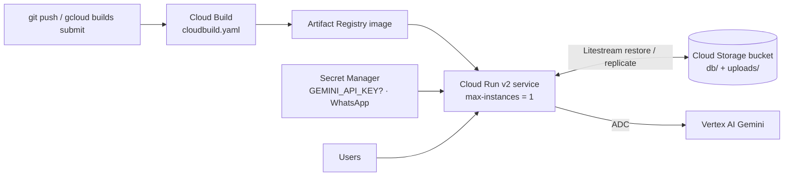

# CivicPulse — Technical Design Document (TDD)

| | |
|---|---|
| **Product** | CivicPulse — from complaint to closure, with proof |
| **Version** | 1.0 (MVP, as implemented) |
| **Companion docs** | [PRD.md](PRD.md) · [API.md](API.md) · [DEPLOY_GCP.md](DEPLOY_GCP.md) · [WHATSAPP.md](WHATSAPP.md) |
| **Traceability** | Each section names the PRD requirement(s) it implements (FR-x / NFR-x) |

---

## 1. Design goals and constraints

| Goal | Consequence in the design |
|---|---|
| 48-hour MVP that demos reliably | Single process, single SQLite file, deterministic demo seed, every AI call has a rule/template fallback |
| Verification is the product, not intake | Closure state machine + GPS gate + vision audit + citizen proof are first-class; intake reuses them |
| Works with no model key (NFR-3) | `ResilientAI` wraps Gemini with a heuristic provider; only vision-dependent features degrade |
| Privacy by construction (NFR-4) | Masking/pseudonyms applied at the presentation layer, blurring applied before bytes hit disk |
| Trivially deployable (NFR-6) | One container: FastAPI serves the API, `/uploads`, and the built PWA; Litestream replicates SQLite to GCS |
| Explainable decisions | Routing, scoring and verdicts all return a reason / confidence / breakdown alongside the value |

## 2. System overview



### 2.1 Technology choices

| Layer | Choice | Rationale |
|---|---|---|
| Backend | Python 3.11+, FastAPI, Pydantic v2, uvicorn | Async-capable, typed request/response models, OpenAPI for free at `/docs` |
| Persistence | SQLite in WAL mode via `sqlite3` | Zero-ops; one writer is enough for the MVP; `Store` is the only swap point for Postgres/Firestore |
| AI | `google-genai` SDK, Gemini 2.5 Flash (AI Studio) or Gemini 3 Flash (Vertex AI), structured output with Pydantic `response_schema` | One multimodal call per report; validated JSON; Kannada speech; bounding boxes for blurring |
| Images | Pillow | EXIF GPS extraction, re-encode (metadata strip), resize to 1280 px, region blur |
| Audio | `ffmpeg`/`ffprobe` (optional) | Transcode browser WebM/Opus to FLAC for Gemini; measure duration for the 30 s cap |
| Frontend | React 19, TypeScript 5.8, Vite 6, react-router 7, react-leaflet 5 + OSM tiles | Installable PWA, MediaRecorder + camera capture, no map API key |
| Deploy | Docker (multi-stage), Cloud Run, Terraform, Cloud Build, Litestream | Single image; infra as code; SQLite survives cold starts |

## 3. Repository layout

```
backend/app/
  main.py              create_app(): CORS, gzip, /uploads static, SPA hosting, startup seed
  config.py            pydantic-settings (env / .env)
  domain.py            Category, Agency (+PRD codes), ClusterStatus, Verdict, Hazard, SLA_HOURS, radii, weights
  schemas.py           Pydantic models: Extraction, VerificationResult, EscalationDraft, request bodies
  store.py             SQLite schema, migrations, query helpers
  geo.py               haversine, bbox, wards, hotspots/context, EXIF GPS, normalise_photo, blur_regions
  privacy.py           phone masking (mask_phones / mask_deep / mask_fields)
  demo.py              deterministic Bengaluru seed (no model calls)
  ai/
    base.py            EvidenceAI Protocol, Media, ParseInput
    __init__.py        ResilientAI, build_ai()
    gemini.py          GeminiAI (structured multimodal calls, thinking config, lenient validation)
    heuristic.py       HeuristicAI (keyword classifier, offline fallback)
    templates.py       escalation templates (email / X / RTI)
    audio.py           ffmpeg transcode + duration probe
  services/
    intake.py          ingest(): media → parse → guards → privacy → route → cluster → score
    routing.py         route(): rules + model evidence → RouteDecision
    scoring.py         compute_score(): PRD-weighted ScoreBreakdown
    closure.py         resolve() / citizen_verify() / set_status(): state machine + GPS gate
    notify.py          proof-photo requests (inbox + webhook)
    credibility.py     reporter credibility
    accountability.py  escalation packages, ward scorecard, accountability index, funnel
    present.py         row → API object (labels, masking, pseudonyms, URLs)
    whatsapp.py        Graph API client, draft state machine, webhook processing
  routers/api.py, routers/whatsapp.py
  data/                wards.json, hotspots.json, demo_photos/
backend/tests/         pytest (≈100 tests)
frontend/src/          App.tsx, pages/, components/, i18n/ (en.ts, kn.ts), lib/ (exif, image, geo, storage)
deploy/                Dockerfile entrypoint, cloudbuild.yaml, terraform/
```

## 4. Data model (`store.py`)

All ids are short random strings with a type prefix: `CP-XXXXXX` clusters, `R-XXXXXX` reports, `E-…` events, `V-…` verifications, `N-…` notifications. Timestamps are ISO-8601 UTC strings. JSON-valued columns end in `_json` and are (de)serialised transparently by `_encode/_decode`.



**Indexes:** `clusters(lat,lng)`, `clusters(status)`, `clusters(ward)`, `reports(cluster_id)`, `reports(reporter_id, created_at)`, `reports(lat,lng)`, `verifications(cluster_id)`, `events(cluster_id)`, `notifications(recipient,status)`, `notifications(cluster_id)`, `rejections(reporter_id)`.

**Migrations:** `CREATE TABLE IF NOT EXISTS` for the base schema, then `MIGRATIONS` (per-table list of `ALTER TABLE … ADD COLUMN`) for columns added after the first release, a legacy category-id rewrite (`streetlight → streetlight_outage`, …) and a `reporter_count` backfill. WhatsApp adds its own `wa_drafts` / delivery tables via `whatsapp.ensure_schema()`.

**Spatial queries:** no spatial extension. `bbox_for_radius()` produces a lat/lng bounding box used with the `(lat,lng)` index; exact filtering is done with `haversine_m()` in Python. At MVP scale (thousands of clusters) this is sub-millisecond.

## 5. Intake pipeline (FR-1, FR-2, FR-3, FR-5, FR-8)

`services/intake.ingest()` is the single code path for PWA reports, corroborations, WhatsApp messages and the demo seed.

```mermaid
sequenceDiagram
    participant C as Client
    participant API as routers/api.py
    participant I as intake.ingest
    participant AI as ResilientAI
    participant R as routing.route
    participant S as Store

    C->>API: POST /reports (lat, lng, text?, audio?, photo?, photo_exif?, photo_lat/lng?)
    API->>API: size/type/duration limits (413 / 415 / 422 audio_too_long)
    API->>I: ingest(...)
    I->>I: nearest_ward(), location_context()
    I->>I: photo: has_exif → flag exif_stripped; EXIF GPS vs pin → flag exif_location_far; normalise_photo()
    I->>AI: parse(ParseInput{text, audio, photo, lat, lng, ward, context_hint})
    AI-->>I: Extraction (or heuristic fallback)
    I->>I: guards: not_civic_issue → 422; other & conf<0.3 → 422; same reporter/category/1 km/5 min → 429
    I->>I: stock_or_screenshot flag; blur_regions(sensitive_regions) → write photo/audio to disk
    I->>R: route(extraction, context)
    R-->>I: RouteDecision{agency, reason, confidence, secondary}
    I->>S: find_match(): merge (≤50 m, active) | repeat (≤25 m, ≤180 d, verified) | new
    I->>S: insert/update cluster, insert report, events
    I->>I: rescore()
    I-->>API: IntakeResult
    API-->>C: 201 {report, cluster, merged, repeat_failure, emergency, location_warning}
```

Key decisions:

- **Media stays in memory until accepted.** Nothing is written for rejected submissions; only a `rejections` row (reporter id + code) is kept for credibility.
- **EXIF survives client resizing.** The PWA reads EXIF GPS from the original file (`lib/exif.ts`) and forwards `photo_exif`, `photo_lat`, `photo_lng`, because canvas resizing strips metadata. Server-side EXIF in the uploaded bytes always wins. WhatsApp sets `expect_exif=False` because Meta strips EXIF for everyone.
- **Clustering** (`find_match`): candidates from a bbox of `2 × max(50, 25)` m, same category, sorted by distance. First an *active* cluster within 50 m → merge; else a *Verified resolved* cluster within 25 m fixed in the last 180 days → repeat failure (new cluster with `previous_cluster_id`, hazard `recurring`); else new.
- **Merge semantics:** running centroid, `max_severity`, union of hazards, `reporter_count` = distinct `reporter_id` (anonymous reports count individually), first photo/landmark kept. A merge into `resolved_pending_verification` flips the cluster to `closure_disputed` (`reopened` event).
- **Corroboration** ("I see this too") passes `target_cluster`; the report is pinned to the cluster's own location; the router enforces ≤ 250 m (+ device accuracy, capped) → `422 too_far`.
- **Emergency** is a flag from the parser (`is_emergency`); it produces an `emergency_flagged` event and a `Call 112` payload but never changes routing (NG1).

### 5.1 AI extraction contract (`schemas.Extraction`)

Fields the parser must return (validated by Pydantic as the Gemini `response_schema`): `is_civic_issue, transcript, transcript_english, language, category, severity (1-5), title, description, landmark, size_estimate, estimated_dimensions_cm{length,width,depth}, hazards[], evidence{recent_digging, utility_work_type, photo_provided, photo_usable, photo_matches_description, people_or_plates_visible, stock_or_screenshot}, suggested_agency, agency_reasoning, confidence, is_emergency, sensitive_regions[{kind, box_2d}]`.

`gemini.try_validate()` applies a lenient pass (`_lenient`) that coerces near-misses (e.g. unknown hazard strings dropped, numeric strings parsed) before raising, so one odd field does not throw away a whole extraction.

## 6. Agency routing (FR-2) — `services/routing.py`

Rules are evaluated in order; each yields a `RouteDecision(agency, reason, confidence, secondary_agency, secondary_reason)`.

| # | Condition | Primary | Rule strength |
|---|---|---|---|
| 1 | Road category and `evidence.utility_work_type` ∈ `UTILITY_OWNER` | water_pipeline/sewage → BWSSB; power_cable → BESCOM; metro → BMRCL; telecom/gas → GBA_ROADS | 0.92 |
| 2 | Road category, digging seen, model suggests a utility agency | model's agency | 0.80 |
| 3 | `road_damage`/trench within 150 m of a `metro_construction` hotspot | BMRCL | 0.85 |
| 4 | Road category, digging seen, utility unknown | GBA_ROADS (enforces road-cut permit) | 0.60 |
| 5 | `other` with a model suggestion | model's agency | 0.55 |
| 6 | `streetlight_outage` and model says BESCOM | BESCOM (supply fault) | 0.70 |
| 7 | Default | `default_agency(category)` | 0.90 (`other`: 0.35) |

`routing_confidence = clamp(strength × (0.5 + 0.5 × extraction.confidence) ± model agreement (+0.05 / −0.10), 0.05, 0.99)`.

`secondary_owner()` adds a co-owner: GBA Roads for resurfacing after any utility/metro road cut; BESCOM for a fallen tree on live wires; Traffic Police when `blocking_traffic`.

## 7. Civic Impact Score (FR-3.2) — `services/scoring.py`

`compute_score()` returns a `ScoreBreakdown{total, components[]}`; each component carries its points and a human-readable reason.

| Component | Weight | Formula |
|---|---|---|
| `unique_reporters` | 35 | `35 × min(1, log2(1+n) / log2(1+10))`, n = distinct citizens |
| `severity` | 30 | low 0.25 · medium 0.5 · high 0.75 · critical 1.0 of 30 |
| `context` | 20 | arterial road 10 *or* junction 5; within 200 m: school 5, hospital 5, one transit hub 4 (capped at 20) |
| `days_elapsed` | 15 | `15 × min(1, days/30)`; the clock stops at `resolved_at` once an official closes the issue; reason text appends "SLA breached by …" when overdue |

Scores are recomputed by `rescore()` after every mutation and by `refresh_scores()` on list reads so `days_elapsed` stays current without a scheduler.

## 8. Closure state machine (FR-4, FR-5) — `services/closure.py`



`RESOLVABLE = {open, in_progress, closure_disputed}`; `VERIFIABLE = {resolved_pending_verification, closure_disputed}`. Invalid transitions raise `InvalidTransition` → `409`.

### 8.1 `resolve()` (official)

1. **GPS gate** — `gps_check()`: position = EXIF in upload → `photo_lat/lng` from client → device `lat/lng` (accuracy, capped at 50 m, allowed as slack). Distance > 50 m ⇒ `UNVERIFIED_DIFFERENT_LOCATION`, `ai_mode="rule"`, **no model call**.
2. **No photo** ⇒ `NO_PROOF_PROVIDED` (rule).
3. **No before-photo on record** ⇒ `INCONCLUSIVE` (rule).
4. Otherwise `ai.verify(before[≤2], after, context_text)` → `VerificationResult{same_location, issue_resolved, fix_quality, verdict, explanation, matched_cues, mismatch_cues, after_sensitive_regions}`.
5. `with_gps_cue()` appends the GPS evidence to the explanation; `location_match` = vision ∧ GPS agree, or GPS alone when vision is inconclusive.
6. After-photo is blurred (`after_sensitive_regions`) and stored as `{cluster}-after-{ts}.jpg`.
7. Status per the diagram; `resolved_at`, `resolved_by`, `verification_verdict`, `closure_count++`.
8. Events `resolved` + `closure_check`; earlier proof requests are expired and `notify.request_verification()` issues a new round.

### 8.2 `citizen_verify()`

Same GPS gate and audit. `VERIFIED` ⇒ `resolved_verified` (+`verified_at`, expire all requests). Any `UNVERIFIED_*` ⇒ `closure_disputed`. `INCONCLUSIVE` leaves status unchanged. The submitter's own request is marked read.

### 8.3 Proof-photo requests (FR-4.4) — `services/notify.py`

Recipients = all `reporter_id`s on the cluster ∪ `nearby_reporters()` (anyone who reported within 200 m in the last 30 days). One `notifications` row per recipient (`kind=verification_request`, `channel=in_app`, payload `{verdict, reason: reporter|nearby}`) plus a best-effort `POST` to `NOTIFY_WEBHOOK_URL` (3 s timeout, failures logged, never block the request). Lifecycle: `unread → read` (citizen submits proof or re-reports) / `expired` (verified, superseded by a new closure).

## 9. AI layer (`ai/`)



- **`ResilientAI`** calls the primary, catches *any* exception, records `last_error` (surfaced at `/health`) and falls back. The returned `ai_mode` string (`gemini`, `heuristic`, `heuristic_fallback`, `rule`, `template`, `seed`) is persisted on every report/verification so the UI can show provenance.
- **`GeminiAI`**: `google-genai` client with either an API key or Vertex AI (`vertex=True`, project, location). Every call sets `response_mime_type=application/json` and `response_schema=<Pydantic model>`. For Gemini 3 models, `thinking_level=minimal` is requested for parse calls (`fast=True`); if the model rejects it the client retries once with `low` and remembers. Parse has its own timeout (`GEMINI_PARSE_TIMEOUT_S`, default 15 s; NFR-1); other calls use `GEMINI_TIMEOUT_S` (60 s).
- **Audio**: `audio.normalise_audio()` transcodes to FLAC 16 kHz mono when `ffmpeg` is present; `probe_duration_s()` enforces the 30 s cap using container metadata or packet timestamps (browser WebM has no duration header).
- **`HeuristicAI`**: keyword classifier for 14 categories in English/Kannada-transliteration/Hindi, severity and hazard keyword tables, regex dimensions (`120x80 cm`), emergency keywords, landmark heuristics. `verify_fix` returns `INCONCLUSIVE`; `draft_escalation` renders `templates.py`.
- **Escalation guard**: `gemini.escalation_problem()` rejects a model draft that drops the cluster id or issue URL, or an X post > 280 chars; the template is used instead (FR-6.3).

## 10. Privacy and anti-abuse (FR-8)

| Concern | Mechanism | Where |
|---|---|---|
| Phone numbers | Regex mask → `98******10` applied with `mask_deep()` to every response object, including nested model output and drafts | `privacy.py`, `services/present.py` |
| Identity | `reporter_id` (device id) is hashed to a stable `citizen-xxxxxx` pseudonym on output; raw ids are never serialised | `present.py` |
| Faces / plates | Parser returns `sensitive_regions` (normalised `box_2d`); `geo.blur_regions()` Gaussian-blurs them with 15 % padding before the file is written; proof photos use `after_sensitive_regions` | `intake.py`, `closure.py`, `geo.py` |
| Photo metadata | `normalise_photo()` re-encodes to JPEG ≤ 1280 px — EXIF is dropped from the stored file (GPS is read *before* this) | `geo.py` |
| Voice notes | Random 6-byte token in the filename; `audio_url` only in the reporter's own `POST /reports` response unless `PUBLIC_AUDIO=true` | `intake.py`, `present.py` |
| Provenance | `photo_flags`: `exif_stripped`, `exif_location_far` (> 500 m), `stock_or_screenshot`, `faces_or_plates_blurred` | `intake.py` |
| Duplicate / spam | 1 km / 5 min same-reporter-same-category guard (`429 + Retry-After`); scoring on unique citizens; `is_civic_issue` and low-confidence bounces | `intake.py`, `scoring.py` |
| Credibility | `(3 + confirmed) / (5 + confirmed + flagged + 2·rejected)`; display-only | `credibility.py` |
| WhatsApp | Sender phone → salted hash key; `X-Hub-Signature-256` verified; body ≤ 1 MB; message-id dedupe | `services/whatsapp.py` |
| Static hosting | SPA catch-all resolves the path and checks `is_relative_to(dist)` to block traversal | `main.py` |

## 11. Accountability features (FR-6, FR-7, FR-10) — `services/accountability.py`

- **Escalation package** (`build_package(scope=cluster|ward)`): collects clusters (for a ward: `closure_disputed` ∪ SLA-breached open issues, grouped by agency), computes a `failure_reason` per cluster, renders three drafts from `templates.py` (email with cc secondary agency; X ≤ 280 chars with cluster id; RTI citing Section 6(1)), concatenates to `text` with a `filename`, and logs an `escalation_drafted` event. Absolute links use `PUBLIC_BASE_URL` or the request host. Linked `external_ref` is cited.
- **Ward scorecard** (`ward_scorecard()`): one pass over all clusters grouped by ward computing counts per status, closure rates (`closures` = `resolved_at` set, even if later reopened), `avg_hours_to_close`, `avg_hours_to_verified_fix`, SLA breach/compliance, repeat-failure rate, `top_agency`, `top_problem` (priority: disputed → repeat_failure → overdue → open → awaiting_proof).
- **Accountability index**: `0.40·verified_closure_rate + 0.30·sla_compliance + 0.15·(1−repeat_rate) + 0.15·(1−disputed_rate)`; neutral 50 for the verified term when there are no closures; grades A ≥ 85, B ≥ 70, C ≥ 55, D ≥ 40, else F; `low_data` < 3 closures. Rows are ranked worst-first.
- **City funnel** (`closure_funnel()`): reports → issues (`duplicates_merged_pct`) → closed → AI-checked → citizen-verified / awaiting proof / disputed.

## 12. API surface

The complete contract (objects, query params, error codes) is in [API.md](API.md). Summary:

| Area | Endpoints |
|---|---|
| Meta | `GET /health`, `GET /meta`, `GET /stats` |
| Intake | `POST /reports`, `GET /reports/{id}`, `POST /clusters/{id}/corroborate` |
| Issues | `GET /clusters`, `GET /clusters/{id}`, `POST /clusters/{id}/status` |
| Closure | `POST /clusters/{id}/resolve`, `POST /clusters/{id}/verify` |
| Accountability | `POST /clusters/{id}/escalate`, `POST /clusters/{id}/escalation-package`, `POST /wards/{ward}/escalation-package`, `GET /wards/scorecard`, `POST /clusters/{id}/external-ref` |
| Inbox | `GET /notifications`, `POST /notifications/read` |
| WhatsApp | `GET/POST /whatsapp/webhook` |
| Demo | `POST /admin/seed`, `POST /admin/reset` (only when `DEMO_MODE=true`) |

Cross-cutting: CORS from `CORS_ORIGINS`; gzip above 1 KB; `/uploads/*` static; the built PWA at `/` with SPA fallback.

## 13. Frontend design

| Element | Implementation |
|---|---|
| Routes | `/` map (`MapPage`), `/report` wizard (`ReportPage`), `/clusters/:id` (`ClusterPage`), `/scorecard` (`ScorecardPage`) |
| State | `AppContext` (meta, language, official mode, device/reporter id in `localStorage`, unread inbox count) |
| Capture | `VoiceRecorder` (MediaRecorder, 30 s cap), `PhotoInput` (camera capture; `lib/exif.ts` reads GPS + presence of EXIF *before* `lib/image.ts` resizes), `LocationPicker` (Geolocation API + draggable Leaflet pin + demo presets) |
| Issue page | `Timeline` (events), `VerificationCard` (verdict, cues, GPS distance, before/after), `ActionPanels` (official: status/resolve; citizen: corroborate/verify; escalation per channel + package), `Provenance` (photo flags, credibility, `ai_mode`) |
| Scorecard | `components/scorecard/*` + `WardEscalation`; CSV export via `lib/csv.ts` |
| i18n | `i18n/index.tsx` context with `en.ts` / `kn.ts` dictionaries; vocabulary translated by id, free text verbatim; `?lang=kn` deep link; persisted per device; `format.ts` renders `YYYY-MM-DD` IST |
| PWA | Vite manifest + icons (`npm run icons`); dev server proxies `/api` and `/uploads` to `:8000` |

## 14. Configuration

All settings come from environment variables / `.env` via `config.Settings` (pydantic-settings). Highlights:

| Variable | Default | Purpose |
|---|---|---|
| `GEMINI_API_KEY`, `GEMINI_MODEL` | `""`, `gemini-2.5-flash` | Enable Gemini; empty key ⇒ heuristic mode |
| `GEMINI_USE_VERTEX`, `GOOGLE_CLOUD_PROJECT`, `GOOGLE_CLOUD_LOCATION` | `false`, `""`, `global` | Vertex AI with ADC instead of a key |
| `GEMINI_TIMEOUT_S`, `GEMINI_PARSE_TIMEOUT_S` | 60, 15 | Call timeouts (parse is on the citizen's critical path) |
| `DATABASE_PATH`, `UPLOADS_DIR` | `backend/data/…` | Storage |
| `LITESTREAM_REPLICA_URL` | unset | Cloud Run: replicate SQLite to GCS |
| `MAX_IMAGE_MB`, `MAX_AUDIO_MB`, `MAX_AUDIO_S` | 10, 10, 30 | Intake limits |
| `DUPLICATE_WINDOW_S`, `DUPLICATE_RADIUS_M` | 300, 1000 | Anti-spam guard (0 disables) |
| `NOTIFY_WEBHOOK_URL` | `""` | Relay proof requests to a WhatsApp/SMS bridge |
| `PUBLIC_AUDIO`, `PUBLIC_BASE_URL`, `CORS_ORIGINS` | `false`, `""`, `*` | Privacy / links / CORS |
| `WHATSAPP_VERIFY_TOKEN`, `WHATSAPP_APP_SECRET`, `WHATSAPP_ACCESS_TOKEN`, `WHATSAPP_PHONE_NUMBER_ID` | unset | WhatsApp intake (off until verify token is set) |
| `DEMO_MODE`, `SEED_ON_STARTUP` | `true`, `false` | Admin endpoints; seed empty DB on boot |

Geo tunables (`domain.py`): `CLUSTER_RADIUS_M=50`, `REPEAT_FAILURE_RADIUS_M=25`, `REPEAT_FAILURE_WINDOW_DAYS=180`, `VERIFY_GPS_RADIUS_M=50`, `VERIFY_REQUEST_NEARBY_M=200`, `VERIFY_REQUEST_LOOKBACK_DAYS=30`, `CORROBORATE_MAX_M=250`, `PHOTO_LOCATION_WARN_M=500`, `CONTEXT_PROXIMITY_M=200`, `MIN_PARSE_CONFIDENCE=0.3`, `SLA_HOURS` per category.

## 15. Deployment (NFR-6)



- **Image** (`Dockerfile`): stage 1 `node:22-alpine` builds the PWA; stage 2 `python:3.12-slim` installs `ffmpeg`, Litestream 0.3.13 and the backend, copies `frontend/dist`, exposes 8080, runs `deploy/entrypoint.sh`.
- **Entrypoint**: without `LITESTREAM_REPLICA_URL` → plain `uvicorn --proxy-headers`. With it → `litestream restore -if-db-not-exists`, force WAL, then `litestream replicate -exec uvicorn …` so every change streams to GCS and a final sync runs on shutdown.
- **Terraform** (`deploy/terraform`): enables APIs, Artifact Registry repo, data + build buckets, two service accounts (run, build) with least-privilege IAM (bucket objects, Vertex AI user, secret accessor), `google_cloud_run_v2_service` with a GCS volume for uploads, env wiring, and public invoker binding. Walkthrough in [DEPLOY_GCP.md](DEPLOY_GCP.md).
- **Single-writer constraint:** SQLite + Litestream require exactly one instance (`max_instances=1`). This is the documented scale ceiling of the MVP (PRD NG4).

## 16. Testing strategy (NFR-8)

`cd backend && pytest -q` — ~100 tests, no network, no model key required (`conftest.py` builds an app with a temp DB and `HeuristicAI`, plus fakes for Gemini/WhatsApp).

| File | Covers |
|---|---|
| `test_geo_and_heuristics.py` | haversine, bbox, ward lookup, EXIF GPS parsing, photo normalisation, heuristic classifier/severity/emergency |
| `test_routing_and_scoring.py` | every routing rule, secondary owner, confidence blending, PRD score weights and clock-stop |
| `test_intake_and_closure.py` | 50 m merge, centroid, duplicate guard, repeat failure, GPS gate (exif/device/slack), state machine, proof requests, blurring |
| `test_prd_alignment.py` | FR-by-FR acceptance criteria: parser shape, verdicts, repair_quality, escalation content/length, external ref, privacy masking |
| `test_scorecard.py` | ward aggregates, accountability index/grades, funnel, `top_problem` priority |
| `test_api.py` | HTTP contract, error codes (413/415/422/429/409), SPA hosting, migrations on an old DB file |
| `test_whatsapp.py` | handshake, signature check, media download, draft state machine, replies, dedupe |
| `test_demo seed` (in the above) | deterministic seed loads, is idempotent, and matches the demo script |

Frontend: `npm run typecheck` (strict TS). `scripts/ai_probe.py` is a manual smoke test for a live Gemini key.

## 17. Observability and operations

- `GET /health` → `{ai_mode, model, last_ai_error, counts, demo_mode, features{whatsapp, public_audio, face_blur}}` (NFR-7).
- Structured logs via `logging` (`civicpulse.*` loggers); every AI fallback logs a stack trace once and records `last_error`.
- `ai_mode` is persisted per report/verification, so data quality can be audited after the fact.
- No background scheduler: time-dependent values (`days_elapsed`, SLA breach) are recomputed on read.

## 18. Security considerations

- No authentication in the MVP: "Official mode" is a UI toggle (`actor` is free text). **Before production**, put official endpoints (`/status`, `/resolve`, `/external-ref`, `/admin/*`) behind IAP or signed JWTs; `DEMO_MODE=false` already disables `/admin/*`.
- Upload hardening: size caps, MIME allow-list, Pillow re-encode (neutralises malformed images), random audio filenames, path-traversal guard on static hosting.
- WhatsApp webhook: HMAC signature, verify token, 1 MB body cap, media size cap, phone numbers never stored raw.
- Secrets only via env/Secret Manager; `.env` is git-ignored.

## 19. Known trade-offs and future work

| Trade-off | Why it is acceptable now | Path forward |
|---|---|---|
| SQLite, one instance | Demo/pilot scale; zero ops | Implement `Store` on Postgres/Firestore; move uploads to GCS signed URLs |
| Haversine over bbox, no PostGIS | Thousands of rows | PostGIS / H3 index when city-scale |
| Ward centroids, not polygons | GBA GeoJSON unavailable (PRD OQ-2) | Point-in-polygon lookup once boundaries are published |
| Synchronous Gemini call on intake | p95 < 5 s met with Flash + 15 s cut-off | Queue + optimistic ticket if latency regresses |
| No auth for officials | Hackathon scope | IAP / OIDC + role claims |
| In-app inbox + webhook, no SMS | Keeps MVP dependency-free | WhatsApp template messages via the existing Graph client (OQ-5) |
| Exact locations public | Needed for verification UX | Coarse public coordinates with exact ones for verifiers (OQ-6) |
